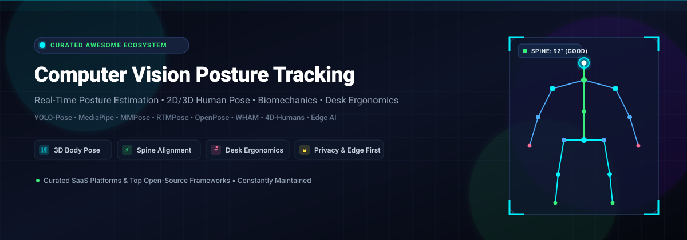

# Awesome Computer Vision Posture Tracking 🧘‍♂️👁️

<p align="center">
  
</p>

<p align="center">
  <a href="https://github.com/ishandutta2007/Awesome-Awesome-Awesome"></a>
  <a href="https://discord.gg/jc4xtF58Ve"></a>
  <a href="https://github.com/ishandutta2007/Awesome-Computer-Vision-Posture-Tracking/stargazers"></a>
  <a href="https://github.com/ishandutta2007/Awesome-Computer-Vision-Posture-Tracking/network/members"></a>
  <a href="https://github.com/ishandutta2007/Awesome-Computer-Vision-Posture-Tracking/blob/main/LICENSE"></a>
  <a href="https://github.com/ishandutta2007"></a>
</p>

---

## 🌟 Top Computer Vision & Real-Time Posture Tracking Ecosystem

**A comprehensive, curated collection of top SaaS platforms and open-source GitHub repositories for Computer Vision Posture Tracking, Real-Time Ergonomic Monitoring, 2D/3D Skeletal Pose Estimation, and Biomechanical Analysis.**

> **Keywords / SEO Highlights:** *Computer Vision Posture Tracking, Human Pose Estimation, Real-Time Ergonomics, Spine Alignment, Desk Slouch Detector, MediaPipe Pose, YOLO-Pose, MMPose, RTMPose, OpenPose, 3D Mesh Recovery, SMPL Body Model, Biomechanics AI, Webcam Sitting Posture Monitoring, Edge AI Keypoint Detection.*

**📅 Last updated: November 2026**

---

### 📖 Overview

Poor ergonomic posture during extended computer work causes musculoskeletal fatigue, spinal misalignment, and neck strain. Modern **Computer Vision & Posture Tracking** algorithms allow webcams, mobile phones, and edge cameras to detect anatomical skeletal landmarks, quantify spinal angles, analyze joint kinematics, and provide real-time ergonomic feedback—completely client-side with zero cloud privacy leaks.

This repository catalogs:
- 🏢 **Enterprise SaaS & MLOps Platforms**: High-throughput annotation, model training, and continuous video inference for biomechanics.
- 💻 **Open-Source Frameworks & Runtimes**: State-of-the-art 2D/3D keypoint detection, whole-body tracking, and turnkey desktop posture reminder tools.

Contributions welcome! See [How to Contribute](#-how-to-contribute).

---

## 📑 Table of Contents

- [📊 Sector Overview & Market Dynamics](#-sector-overview--market-dynamics)
- [🏢 SaaS/Hosted Platforms](#-saashosted-platforms)
- [💻 Open-Source GitHub Projects](#-open-source-github-projects)
- [🛠️ Keypoint & Pose Estimation Architecture](#️-keypoint--pose-estimation-architecture)
- [🤝 How to Contribute](#-how-to-contribute)
- [💖 Support & Sponsorship](#-support--sponsorship)
- [⭐ Star History](#-star-history)
- [⚠️ Disclaimer](#️-disclaimer)

---

## 📊 Sector Overview & Market Dynamics

The computer vision posture tracking and digital ergonomic market is valued between **$350 million and $1.5 billion** (spanning digital posture analytics software, AI safety vision, and smart corrective applications, positioned within the broader $20B+ computer vision and $25B+ ergonomic workplace solutions ecosystems) and is growing at a robust **8% to 18% CAGR**.

The sector is currently **moderately to highly fragmented** at the application level across specialized wellness startups, corporate workplace safety vendors, and telehealth physical therapy providers. However, foundational AI data infrastructure, cloud annotation backends, and MLOps tooling demonstrate noticeable consolidation around a handful of large-scale industry platforms.

---

## 🏢 SaaS/Hosted Platforms

The following SaaS and hosted platforms provide scalable keypoint annotation, pose tracking data pipelines, edge-to-cloud computer vision deployments, and workplace ergonomic safety monitoring. The table is sorted by **Company Size (Valuation / Revenue) descending**:

| Platform | Company Size (Valuation / Revenue) | Description | Pricing (Starting Tier) | Free Tier Limits |
| :--- | :--- | :--- | :--- | :--- |
| **[Scale AI (Nucleus & Rapid)](https://scale.com)** | **$29.0B Valuation** (~$1.0B Revenue) | Enterprise AI data infrastructure delivering high-volume 2D/3D human pose and biomechanical keypoint annotation. | **$0.05 / task** (Rapid pay-as-you-go self-serve; custom enterprise tiers for high-volume pipelines) | **200 free labeling units/month** on Scale Rapid self-serve. |
| **[Labelbox](https://labelbox.com)** | **$1.25B Valuation** (~$35M–$50M Revenue) | Enterprise data-centric AI platform offering customizable skeletal keypoint templates and pose labeling. | **$0.10 / LBU** (Labelbox Unit on consumption Starter tier; custom annual commitments for Enterprise) | **500 free LBUs/month**, up to 30 users, and 1,500 API calls/minute. |
| **[Clarifai](https://clarifai.com)** | **$775M Valuation** (~$10M–$16M Revenue) | Full-stack cloud AI platform providing pre-trained human pose estimation workflows and custom keypoint training. | **$30.00 / month** (Essential tier; Professional at $300/mo, custom Enterprise) | **Free Community Plan forever**: 1 application and up to 1,000 monthly inputs/operations. |
| **[Encord](https://encord.com)** | **$550M Valuation** (~$15M+ Revenue) | AI-assisted data engine and multimodal annotation platform featuring automated skeletal keypoint interpolation. | **$1,500.00 / month** (Starting annual contract tier (~$18k/yr minimum); custom quotes based on indexed video/frames & seats) | **Free trial / PoC pilot available on demo request** (typically 14-day evaluation for custom enterprise pilot datasets). |
| **[Landing AI (LandingLens)](https://landing.ai)** | **$300M Valuation** (~$15M–$30M Revenue) | Visual inspection and computer vision platform supporting ergonomic workplace monitoring and worker safety posture compliance. | **$39.00 / month** (Starting paid tier for cloud deployment; custom pricing for enterprise edge) | **Free Plan forever**: 1,000 credits/month, up to 3 users, 1 active model download (non-commercial use). |
| **[Roboflow](https://roboflow.com)** | **$200M Valuation** (~$12M Revenue) | End-to-end cloud computer vision platform supporting keypoint/skeleton annotation and custom YOLO-Pose model training. | **$39.00 / month** (Starter Credit Pack; custom quotes for Enterprise) | **Free Plan forever**: 10 monthly credits, 3 private projects, up to 10,000 images, public workspace sharing. |
| **[SuperAnnotate](https://superannotate.com)** | **$175M Valuation** (~$10M–$15M Revenue) | Enterprise annotation and AI data platform enabling multi-person skeletal keypoint labeling and occluded joint tagging. | **$150.00 / month** (Starting custom Starter tier with 1,000 Orchestrate compute hours; billed annually via sales quote) | **Free Starter plan**: Up to 5,000 items and 3 team members. |
| **[V7 Labs (V7 Darwin)](https://v7labs.com)** | **$150M Valuation** (~$8M–$12M Revenue) | Cloud computer vision training data platform supporting sub-pixel keypoint placement and temporal pose tracking. | **$499.00 / month** (Starter/Team tier billed annually at $5,400/yr; includes 1 workspace, 3 seats, 50k files) | **14-day free trial on demo request** with full feature access and platform evaluation limits. |
| **[Dataloop](https://dataloop.ai)** | **$120M Acquisition** (~$10M Revenue) | Cloud data management and automated video annotation environment uniting keypoint skeleton labeling with pipelines. | **$500.00 / month** (Custom entry subscription based on studio user time and data ingestion volume) | **Free developer account with 14-day pilot evaluation** upon guided demo onboarding. |
| **[Chooch](https://chooch.com)** | **$80M Valuation** (~$10M Revenue) | Enterprise edge-to-cloud vision AI platform offering real-time ergonomic safety monitoring and posture analytics on CCTV. | **$100.00 / month** (Starting API entry plan and edge stream licensing; custom quotes for enterprise plants) | **Free account forever** with introductory recurring $5/month AI usage credit and ReadyNow™ model exploration. |

---

## 💻 Open-Source GitHub Projects

Explore the premier open-source repositories for human pose estimation, real-time webcam posture tracking, and biomechanical video analysis. Sorted by **GitHub Star Count descending**:

- **[Ultralytics YOLO-Pose](https://github.com/ultralytics/ultralytics)** [](https://github.com/ultralytics/ultralytics/stargazers)  
  Industry-standard real-time multi-person keypoint detection and postural pose tracking framework with instant ONNX, TensorRT, CoreML, and edge mobile deployment.

- **[Roboflow Supervision](https://github.com/roboflow/supervision)** [](https://github.com/roboflow/supervision/stargazers)  
  Reusable computer vision and multi-modal pipeline toolkit offering keypoint skeletal visualizations, zone-based posture triggers, and video inference utilities.

- **[Google MediaPipe Pose Landmarker](https://github.com/google-ai-edge/mediapipe)** [](https://github.com/google-ai-edge/mediapipe/stargazers)  
  Blazing-fast cross-platform ML solution detecting 33 full 3D body landmarks (shoulders, ears, hips, spinal inclination) running client-side on CPU/GPU and web browsers.

- **[OpenPose](https://github.com/CMU-Perceptual-Computing-Lab/openpose)** [](https://github.com/CMU-Perceptual-Computing-Lab/openpose/stargazers)  
  Pioneering real-time multi-person 2D/3D body, foot, hand, and facial keypoint detection library widely utilized in clinical ergonomics and biomechanics research.

- **[Label Studio](https://github.com/HumanSignal/label-studio)** [](https://github.com/HumanSignal/label-studio/stargazers)  
  Leading open-source data labeling and annotation tool supporting custom human pose skeleton templates, multi-annotator workflows, and ML-assisted pre-labeling.

- **[CVAT (Computer Vision Annotation Tool)](https://github.com/cvat-ai/cvat)** [](https://github.com/cvat-ai/cvat/stargazers)  
  Flagship self-hosted interactive video and image annotation suite with automatic skeleton keypoint interpolation, frame-by-frame tracking, and team QA.

- **[MoveNet / TensorFlow.js Pose Detection](https://github.com/tensorflow/tfjs-models)** [](https://github.com/tensorflow/tfjs-models/stargazers)  
  Ultra-fast browser-native pose estimation models (MoveNet Lightning/Thunder & BlazePose) executing 100% locally via WebGL/WebGPU with zero server uploads.

- **[AlphaPose](https://github.com/MVIG-SJTU/AlphaPose)** [](https://github.com/MVIG-SJTU/AlphaPose/stargazers)  
  Accurate real-time multi-person whole-body pose estimation and tracking system capable of handling complex postures, occlusions, and multi-subject crowds.

- **[MMPose & RTMPose](https://github.com/open-mmlab/mmpose)** [](https://github.com/open-mmlab/mmpose/stargazers)  
  Comprehensive open-source PyTorch toolbox for 2D/3D human pose estimation; includes RTMPose for ultra-low-latency, real-time edge posture and ergonomic tracking.

- **[HRNet (High-Resolution Net for Pose)](https://github.com/leoxiaobin/deep-high-resolution-net.pytorch)** [](https://github.com/leoxiaobin/deep-high-resolution-net.pytorch/stargazers)  
  State-of-the-art high-resolution representation network maintaining high-resolution representations throughout the vision backbone for precise joint localization.

- **[VIBE](https://github.com/mkocabas/VIBE)** [](https://github.com/mkocabas/VIBE/stargazers)  
  Video Inference for Human Body Pose and Shape Estimation generating accurate temporal 3D SMPL body meshes from monocular RGB video feeds.

- **[FrankMocap](https://github.com/facebookresearch/frankmocap)** [](https://github.com/facebookresearch/frankmocap/stargazers)  
  Fast and easy-to-use single-view 3D whole-body motion capture system producing synchronized 3D hand and body pose meshes from monocular cameras.

- **[Lightweight Human Pose Estimation](https://github.com/Daniil-Osokin/lightweight-human-pose-estimation.pytorch)** [](https://github.com/Daniil-Osokin/lightweight-human-pose-estimation.pytorch/stargazers)  
  PyTorch implementation of Lightweight OpenPose running real-time 2D multi-person pose estimation at 26+ FPS on standard CPUs for local desktop posture trackers.

- **[ViTPose](https://github.com/ViTAE-Transformer/ViTPose)** [](https://github.com/ViTAE-Transformer/ViTPose/stargazers)  
  Simple yet powerful Vision Transformer baseline for 2D human pose estimation achieving state-of-the-art accuracy on COCO, MPII, and whole-body benchmarks.

- **[4D-Humans (HMR 2.0)](https://github.com/shubham-goel/4D-Humans)** [](https://github.com/shubham-goel/4D-Humans/stargazers)  
  Transformer-based 3D human mesh recovery and tracking system estimating full SMPL body posture, spinal curvature, and shape from arbitrary RGB videos.

- **[HMR (End-to-end Human Mesh Recovery)](https://github.com/akanazawa/hmr)** [](https://github.com/akanazawa/hmr/stargazers)  
  Foundational end-to-end adversarial framework reconstructing 3D human mesh models and joint orientations from a single 2D image.

- **[OpenPifPaf](https://github.com/openpifpaf/openpifpaf)** [](https://github.com/openpifpaf/openpifpaf/stargazers)  
  Composite Fields framework for semantic keypoint detection and spatio-temporal association, excelling at multi-person posture tracking in urban and athletic environments.

- **[HyperPose (OpenPose-Plus)](https://github.com/tensorlayer/HyperPose)** [](https://github.com/tensorlayer/HyperPose/stargazers)  
  Flexible, high-performance C++ and Python library for building real-time human pose estimation and biomechanics engines on edge devices.

- **[WHAM (World-grounded Human Motion)](https://github.com/yohanshin/WHAM)** [](https://github.com/yohanshin/WHAM/stargazers)  
  Accurate 3D human posture and global trajectory recovery framework combining video features with foot-contact dynamics for realistic movement tracking.

- **[COCO-WholeBody](https://github.com/jin-s13/COCO-WholeBody)** [](https://github.com/jin-s13/COCO-WholeBody/stargazers)  
  Whole-body human keypoint dataset and benchmark annotating 133 keypoints per person (body, face, hands, and feet) for granular postural analysis.

- **[wquguru/shisei](https://github.com/wquguru/shisei)** [](https://github.com/wquguru/shisei/stargazers)  
  Dedicated open-source posture reference and local ergonomic desktop tracking tool using webcam computer vision to detect slouching and spine misalignment.

- **[OpenCap](https://github.com/opencap-org/opencap-core)** [](https://github.com/opencap-org/opencap-core/stargazers)  
  Stanford open-source smartphone-based 3D human movement and musculoskeletal biomechanics engine measuring joint angles, spine angles, and gait kinematics.

---

## 🛠️ Keypoint & Pose Estimation Architecture

```
                  ┌────────────────────────────────────────┐
                  │       RGB Camera / Webcam Stream       │
                  └───────────────────┬────────────────────┘
                                      │
                                      ▼
                  ┌────────────────────────────────────────┐
                  │   2D/3D Landmark Extraction Engine     │
                  │  (MediaPipe / YOLO-Pose / RTMPose)     │
                  └───────────────────┬────────────────────┘
                                      │
            ┌─────────────────────────┴────────────────────────┐
            ▼                                                  ▼
┌───────────────────────────────┐              ┌───────────────────────────────┐
│     Spine & Neck Metrics      │              │      3D Mesh & Kinematics     │
│  - Ear-to-Shoulder Alignment  │              │  - SMPL Body Representation   │
│  - Forward Head Slouch (cm)   │              │  - Range of Motion (ROM)      │
│  - Thoracic Kyphosis Angle    │              │  - Joint Angular Velocity     │
└───────────────┬───────────────┘              └───────────────┬───────────────┘
                │                                              │
                └───────────────────────┬──────────────────────┘
                                        │
                                        ▼
                  ┌────────────────────────────────────────┐
                  │ Real-Time Feedback & Ergonomic Alert   │
                  │  - Desktop Notifications & Warnings    │
                  │  - Posture Score & Historical Trends   │
                  └────────────────────────────────────────┘
```

---

## 🤝 How to Contribute

Contributions are warmly welcomed! Help keep this repository up-to-date by submitting new tools, datasets, or libraries:

1. 🍴 **Fork the repository** on GitHub.
2. 🌿 **Create a descriptive feature branch** (`git checkout -b feature/add-new-posture-tool`).
3. 📝 **Edit `README.md`**: Follow the established formatting (include links, star badges with `style=social&color=white`, and factual descriptions).
4. 📬 **Open a Pull Request** with a brief summary of what you added and why it benefits the community.

---

## 💖 Support & Sponsorship

Thank you for exploring this project! 🌟 

If this curated repository saved you research time, helped your posture, or assisted your engineering projects, please consider showing your support:

- ⭐ **Star this repository** to help other developers and researchers discover it.
- 🍴 **Fork and share** it with colleagues, ergonomists, and open-source communities.
- ☕ **Support on GitHub Sponsors**: If you'd like to support ongoing updates, you can buy me a coffee through the official [GitHub Sponsor Dashboard](https://github.com/sponsors/ishandutta2007)!

<p align="center">
  <a href="https://github.com/sponsors/ishandutta2007">
    
  </a>
</p>

---

## ⭐ Star History

[](https://www.star-history.com/#ishandutta2007/Awesome-Computer-Vision-Posture-Tracking&type=date&legend=top-left)

---

## ⚠️ Disclaimer

- This repository is a **community-curated guide** intended for research, software development, and ergonomic awareness. It is not an endorsement of any commercial platform.
- Software-based posture reminder tools (such as webcam analyzers and MediaPipe apps) are **general wellness utilities**, not medical diagnostic equipment. For persistent neck, spine, or musculoskeletal conditions, always seek guidance from a licensed physician or physical therapist.
- **Privacy First**: We strongly advocate processing webcam video feeds locally on-device via edge models to protect user privacy and comply with privacy regulations.

---

<p align="center">
  <sub>Built with ❤️ for computer vision engineers, biomechanics researchers, and remote-work health advocates.</sub>
</p>
